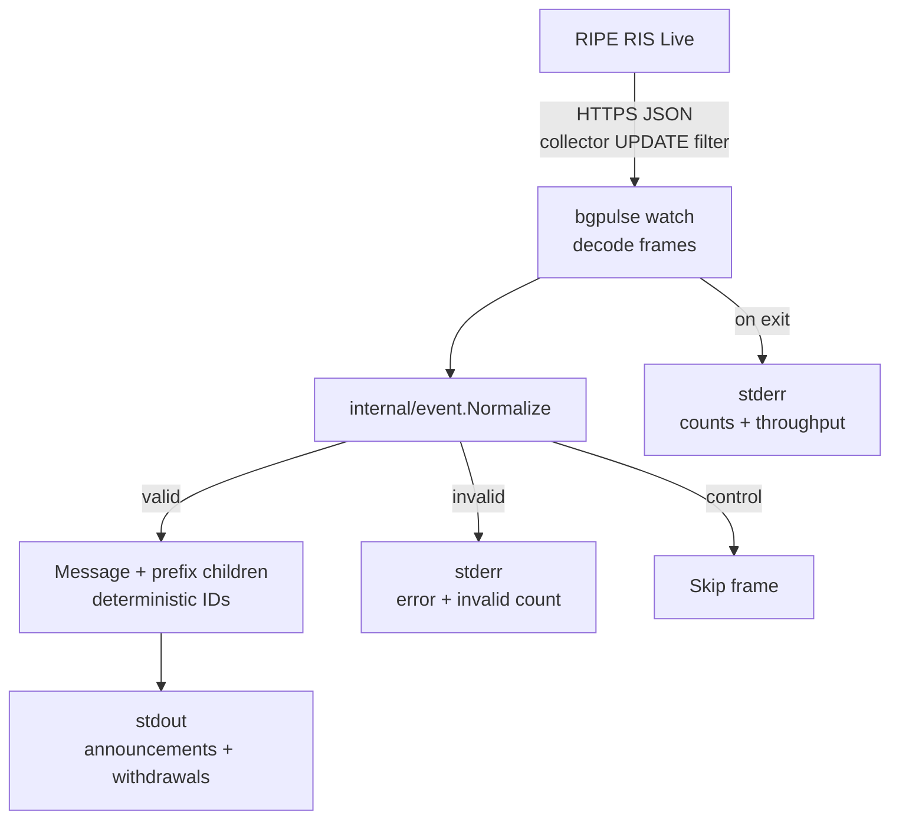
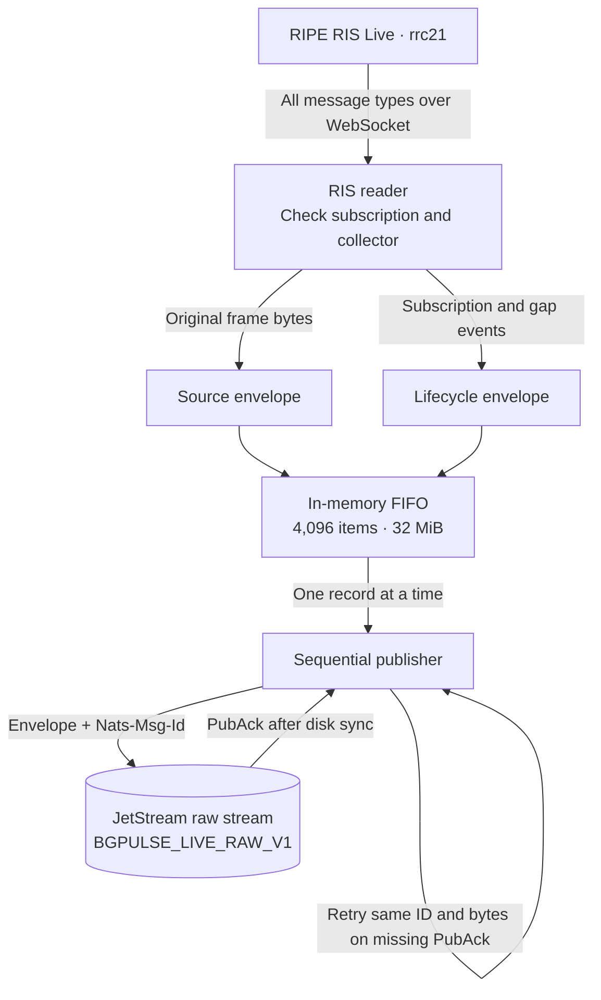
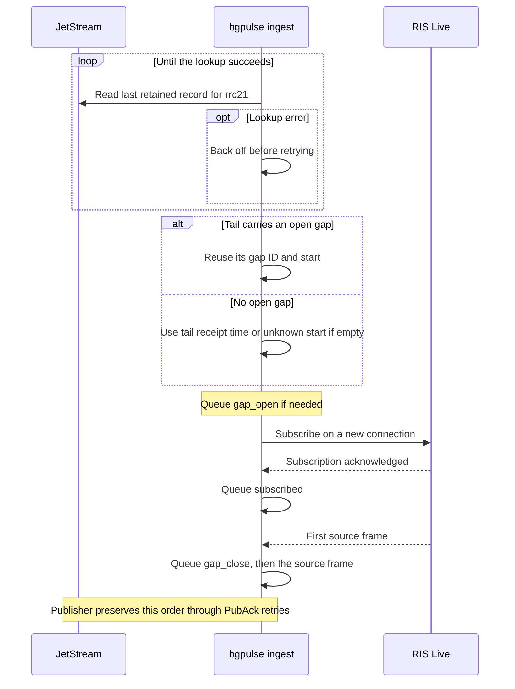
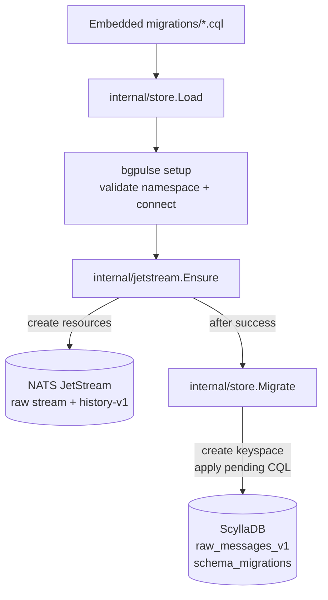

# Current architecture and data flow

BGPulse provides `watch`, `sample`, `setup` and `ingest` in one Go binary.
The diagrams show the current implementation. Provisioning arrows create or
verify resources; they do not carry BGP updates.

## Live observation

`watch` defaults to collector `rrc21`. Normalization validates the whole message,
preserves AS path segments and origin ambiguity, and derives stable message,
observer and child event IDs. Each UPDATE produces withdrawal children followed
by announcement children. Invalid messages are logged and skipped; transport or
decode errors end the command. This path currently writes only to the terminal.

`sample` connects to the same collector over WebSocket for two timed observation
windows. It verifies the subscription acknowledgment after every reconnect,
measures raw JSON bytes, and uses the normalizer to count prefix children.
The JSON report includes rates, distributions, and the first and last observation
on each connection. [Measurement and results](benchmarks/rrc21-sample.md)

## Durable capture

### From a RIS frame to a PubAck

`bgpulse ingest` verifies the live stream, looks up the last retained record for
`bgpulse.live.raw.v1.ris.rrc21`, then opens an acknowledged all-types RIS
subscription. Each WebSocket connection has its own epoch. The reader puts
source and lifecycle envelopes on one FIFO bounded by 4,096 items and 32 MiB
of serialized data. One publisher waits up to 10 seconds per PubAck attempt
and retries the same bytes and `Nats-Msg-Id` before advancing. A full queue
backpressures the socket. The pilot reserves loopback TCP port 7421 as a
same-host duplicate-start guard. Operators must ensure a single ingester
across hosts and container network namespaces.

Source envelopes carry the original frame as base64 in `payload`, its SHA-256,
the deterministic message ID, and receiver and source timestamps. Route
normalization belongs to the history consumer. Bounded data with a malformed
timestamp or missing source ID still reaches the stream for later quarantine.
Frames that exceed transport limits interrupt the connection.

### Recovering a collector gap

When the process restarts, a surviving open gap keeps its identity and start.
Otherwise the previous record's receipt time starts the new gap. An empty
subject gives an unknown start. A failed lookup retries before capture.
The first source frame after an acknowledged subscription closes the gap
before that data record is published. Its closing control includes both
available bounds and leaves the gap unresolved. On disconnect, ingest drains
that epoch in order and retries with exponential full jitter (1 s to 60 s).
SIGINT or SIGTERM stops new reads. A 30 s drain timeout reports unaccepted
records and exits with an error. Pre-PubAck data can be lost on process death.

## Infrastructure provisioning

`setup -check` uses `jetstream.Check` and `store.Check` instead of the creation
path above. It verifies declared JetStream settings, keyspace replication and
applied migration checksums without changing resources.

For the default namespace `live`, setup provisions:

| Component | Resource |
|---|---|
| JetStream | Stream `BGPULSE_LIVE_RAW_V1`, subjects `bgpulse.live.raw.v1.ris.*`, durable consumer `history-v1` with explicit acknowledgments |
| ScyllaDB | Keyspace `bgpulse_live`, raw history table `raw_messages_v1`, migration ledger `schema_migrations` |
| Local deployment | One NATS node and one Scylla node, persistent Compose volumes, localhost ports |

The raw stream uses file storage, one replica, a 20-minute maximum age and a
10 GiB size limit. At the byte limit, `DiscardNew` rejects incoming records.
The pilot budgets 30 minutes of raw and prefix history from source event time.
The future writer must supply the remaining TTL on each insert. The existing
raw table's 24-hour default TTL applies to inserts that omit it. The current
commands provision resources and capture RIS traffic to JetStream. [Capacity worksheet](benchmarks/dev-capacity.md)

The [README roadmap](../README.md#roadmap) describes the planned end-to-end
pipeline, including the planned history writer, routing state, analytics, RPKI
and HTTP API.

Source: [command dispatch and watch](../cmd/bgpulse/main.go),
[ingest and gap recovery](../internal/ingest/ingest.go),
[setup](../cmd/bgpulse/setup.go), [normalization](../internal/event/event.go),
[JetStream resources](../internal/jetstream/jetstream.go),
[schema migration](../internal/store/migrate.go),
[raw history schema](../migrations/0001_raw_messages_v1.cql) and
[local deployment](../deploy/compose.yaml).
