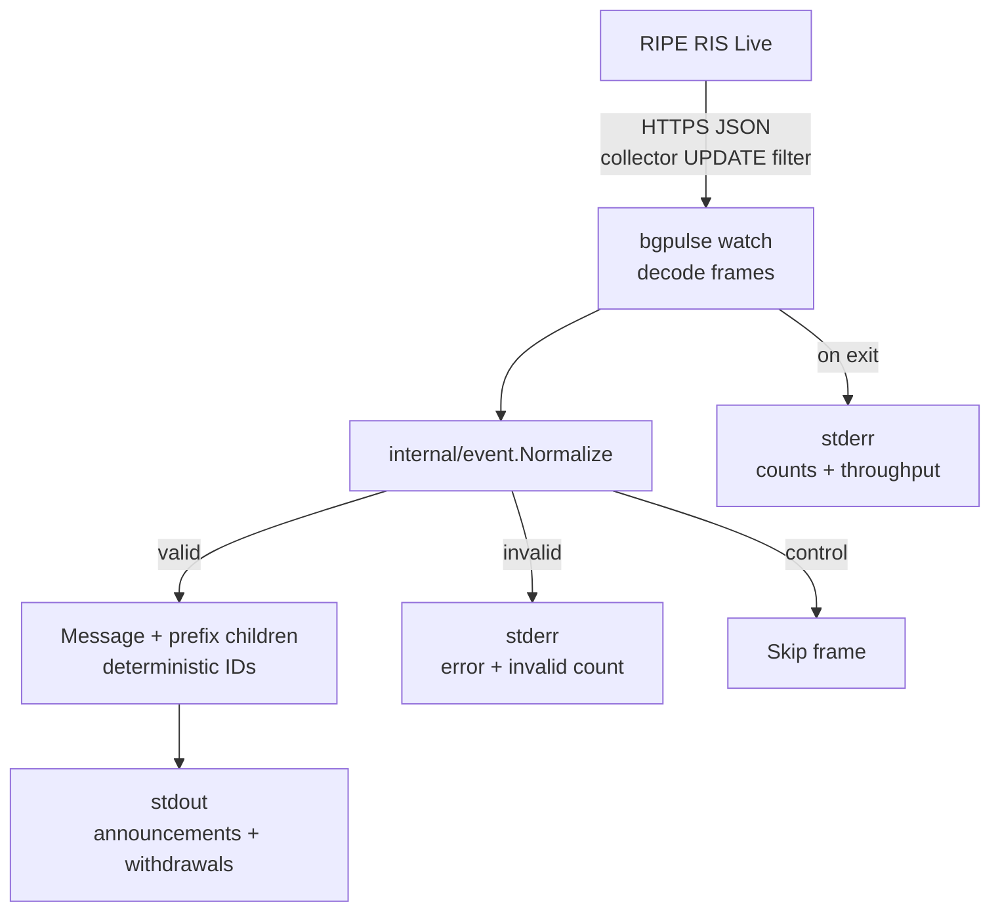
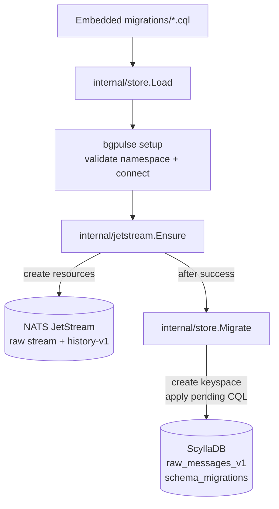

# Current architecture and data flow

BGPulse provides `watch`, `sample` and `setup` in one Go binary.
The diagrams show the current implementation. Provisioning arrows create or
verify resources; they do not carry BGP updates.

## Live observation

`watch` defaults to collector `rrc21`. Normalization validates the whole message,
preserves AS path segments and origin ambiguity, and derives stable message,
observer and child event IDs. Each UPDATE produces withdrawal children followed
by announcement children. Invalid messages are logged and skipped; transport or
decode errors end the command. This path currently writes only to the terminal.

`sample` connects to the same collector over WebSocket for two timed observation
windows. It verifies the subscription acknowledgment after every reconnect,
measures raw JSON bytes, and uses the normalizer to count prefix children.
The JSON report includes rates, distributions, and the first and last observation
on each connection. [Measurement and results](benchmarks/rrc21-sample.md)

## Infrastructure provisioning

`setup -check` uses `jetstream.Check` and `store.Check` instead of the creation
path above. It verifies declared JetStream settings, keyspace replication and
applied migration checksums without changing resources.

For the default namespace `live`, setup provisions:

| Component | Resource |
|---|---|
| JetStream | Stream `BGPULSE_LIVE_RAW_V1`, subjects `bgpulse.live.raw.v1.ris.*`, durable consumer `history-v1` with explicit acknowledgments |
| ScyllaDB | Keyspace `bgpulse_live`, raw history table `raw_messages_v1`, migration ledger `schema_migrations` |
| Local deployment | One NATS node and one Scylla node, persistent Compose volumes, localhost ports |

The raw stream uses file storage, one replica, a 24-hour maximum age and a
10 GiB size limit. The raw history table has a default TTL of 24 hours. These
resources are provisioned, but no implemented worker publishes BGP messages to
JetStream or persists them to Scylla yet.

The [README roadmap](../README.md#roadmap) describes the planned end-to-end
pipeline: ingestion, durable history, routing state, analytics, RPKI and an HTTP
API. Those processing stages are not part of the current runtime diagrams.

Source: [command dispatch and watch](../cmd/bgpulse/main.go),
[setup](../cmd/bgpulse/setup.go), [normalization](../internal/event/event.go),
[JetStream resources](../internal/jetstream/jetstream.go),
[schema migration](../internal/store/migrate.go),
[raw history schema](../migrations/0001_raw_messages_v1.cql) and
[local deployment](../deploy/compose.yaml).
