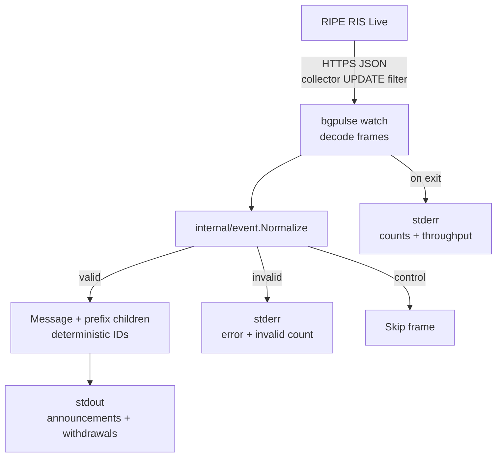
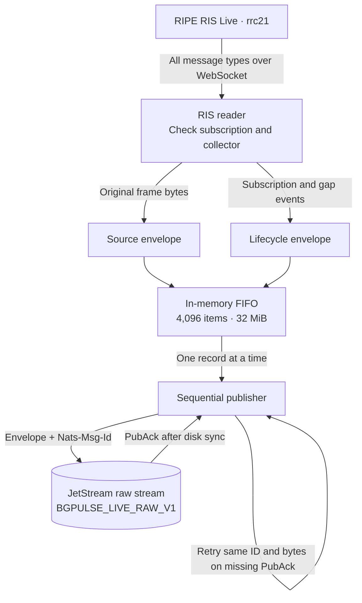
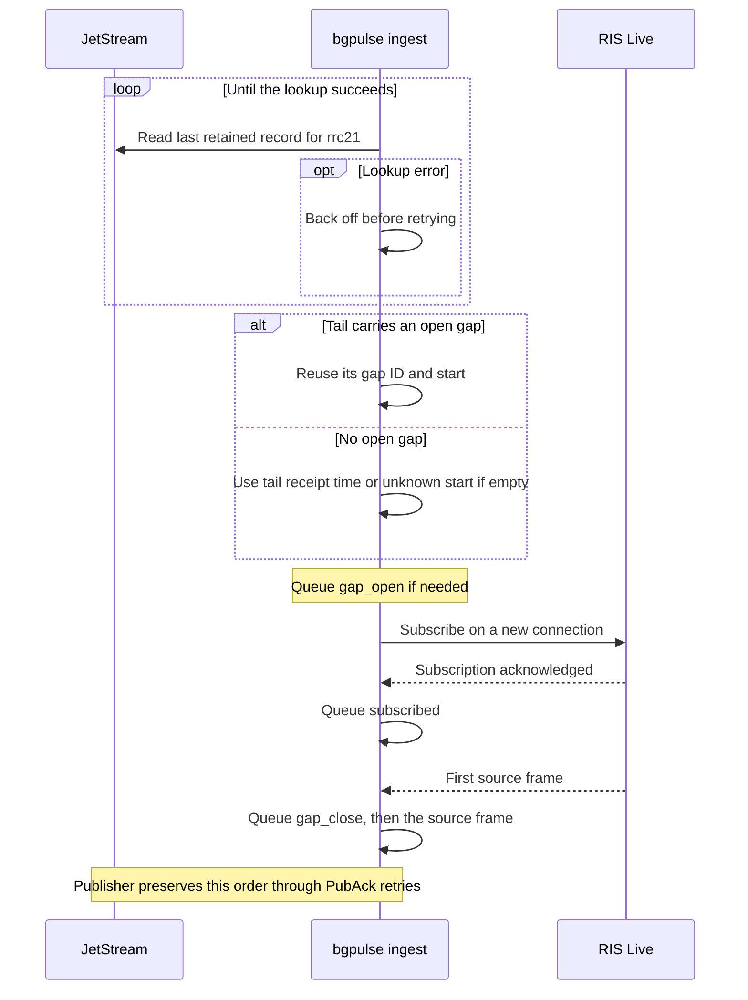
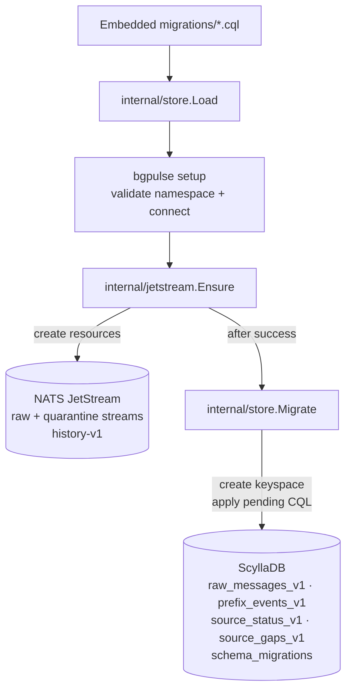
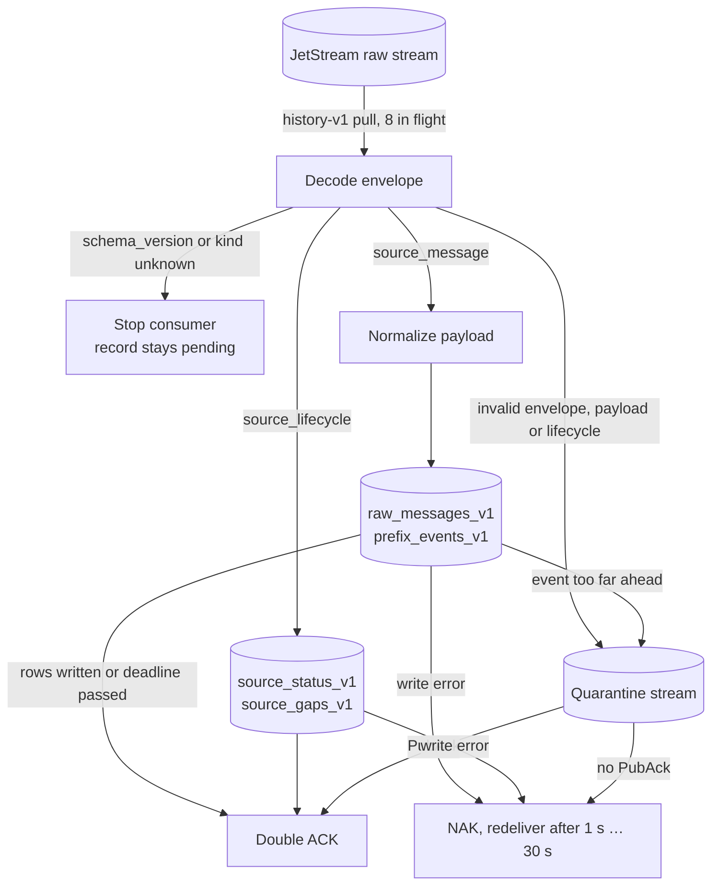

# Current architecture and data flow

BGPulse provides `watch`, `sample`, `setup`, `ingest` and `persist` in one Go binary.
The diagrams show the current implementation. Provisioning arrows create or verify resources; they do not carry BGP updates.

## Live observation

`watch` defaults to collector `rrc21`. Normalization validates the whole message, preserves AS path segments and origin ambiguity, 
and derives stable message, observer and child event IDs. Each UPDATE produces withdrawal children followed by announcement children. 
Invalid messages are logged and skipped; transport or decode errors end the command. This path currently writes only to the terminal.

`sample` connects to the same collector over WebSocket for two timed observation windows. It verifies the subscription 
acknowledgment after every reconnect, measures raw JSON bytes, and uses the normalizer to count prefix children.
The JSON report includes rates, distributions, and the first and last observation on each connection. 
[Measurement and results](benchmarks/rrc21-sample.md)

## Durable capture

### From a RIS frame to a PubAck

`bgpulse ingest` verifies the live stream, looks up the last retained record for `bgpulse.live.raw.v1.ris.rrc21`, then opens 
an acknowledged all-types RIS subscription. Each WebSocket connection has its own epoch. The reader puts source and lifecycle 
envelopes on one FIFO bounded by 4,096 items and 32 MiB of serialized data. One publisher waits up to 10 seconds per PubAck
attempt and retries the same bytes and `Nats-Msg-Id` before advancing. A full queue backpressures the socket. The pilot 
reserves loopback TCP port 7421 as a same-host duplicate-start guard. Operators must ensure a single ingester across hosts 
and container network namespaces.

Source envelopes carry the original frame as base64 in `payload`, its SHA-256, the deterministic message ID, and receiver 
and source timestamps. Route normalization belongs to the history consumer. Bounded data with a malformed timestamp or 
missing source ID still reaches the stream for later quarantine. Frames that exceed transport limits interrupt the connection.

### Recovering a collector gap

When the process restarts, a surviving open gap keeps its identity and start. Otherwise the previous record's receipt time 
starts the new gap. An empty subject gives an unknown start. A failed lookup retries before capture. The first source frame 
after an acknowledged subscription closes the gap before that data record is published. Its closing control includes both
available bounds and leaves the gap unresolved. On disconnect, ingest drains that epoch in order and retries with exponential 
full jitter (1 s to 60 s). SIGINT or SIGTERM stops new reads. A 30 s drain timeout reports unaccepted records and exits with 
an error. Pre-PubAck data can be lost on process death.

## Infrastructure provisioning

`setup -check` uses `jetstream.Check` and `store.Check` instead of the creation path above. It verifies declared JetStream 
settings, keyspace replication and applied migration checksums without changing resources.

For the default namespace `live`, setup provisions:

| Component | Resource |
|---|---|
| JetStream | Stream `BGPULSE_LIVE_RAW_V1`, subjects `bgpulse.live.raw.v1.ris.*`, durable consumer `history-v1` with explicit acknowledgments; stream `BGPULSE_LIVE_QUARANTINE_V1`, subjects `bgpulse.live.quarantine.v1.*` |
| ScyllaDB | Keyspace `bgpulse_live`, history tables `raw_messages_v1` and `prefix_events_v1`, lifecycle tables `source_status_v1` and `source_gaps_v1`, migration ledger `schema_migrations` |
| Local deployment | One NATS node and one Scylla node, persistent Compose volumes, localhost ports |

The raw stream uses file storage, one replica, a 20-minute maximum age and a 10 GiB size limit. At the byte limit, 
`DiscardNew` rejects incoming records. The quarantine stream keeps 7 days or 1 GiB, also with `DiscardNew`. The pilot
budgets 30 minutes of raw and prefix history from source event time.
[Capacity worksheet](benchmarks/dev-capacity.md)

## History rows

`internal/store.History` writes one `raw_messages_v1` row with the exact frame bytes and one `prefix_events_v1` row per 
normalized prefix child. The `persist` consumer calls it for every source record.

| Table | Partition | Clustering |
|---|---|---|
| `raw_messages_v1` | source, collector, UTC 5-minute bucket of event time, shard = first 64 bits of SHA-256(`message_id`) mod 4 | `event_time_us` DESC, `message_id` |
| `prefix_events_v1` | canonical prefix, UTC hour of event time, shard 0 | `event_time_us` DESC, `event_id` |

Each row targets expiry at `event_time + 30m`. Each insert sends the remaining TTL to that deadline, rounded down to whole seconds, 
so a retry aims at the same deadline. Scylla starts a TTL when the write arrives, so a row expires up to one second early, or 
late by the request latency. Exact expiry is not guaranteed. With less than a second left the writer returns `ErrExpired` instead 
of sending TTL 0, which would never expire. Event times more than 5 minutes ahead of the writer clock return `ErrFutureEvent`, and 
persist quarantines them. Keys come from `message_id` and `event_id`, so rewriting a message after a partial failure converges on 
the same rows. Withdrawals leave announcement columns unset rather than null. Both tables use 1-hour TWCS windows, immediate 
tombstone GC and a 30-minute safety-net default TTL. Expiry hides rows from queries, while compaction reclaims their bytes later.

## History consumer

`bgpulse persist` checks the schema, both streams and the `history-v1` consumer, then pulls up to 32 records and handles up to 8 at 
once. A missed consumer heartbeat re-pulls instead of stopping. A record is acknowledged only after every row it needs is written. 
Rows are keyed on deterministic IDs, so a crash between writes or before the ACK leads to a redelivery that rewrites the same rows. 
A record past its history deadline is acknowledged as `expired_before_projection` without a write. Failed writes NAK the record 
with a delay that doubles from 1 s to 30 s per delivery. There is no delivery limit, so a Scylla outage stalls the consumer until 
it recovers or the raw stream's 20-minute age limit drops the record.

Records that can never be projected go to `bgpulse.live.quarantine.v1.<collector>` first: malformed or unversioned envelopes, 
a foreign namespace, payloads the normalizer rejects, a `message_id` that does not match the payload, events more than 5 minutes 
ahead and lifecycle records without a type or gap ID. The quarantine record holds the exact raw bytes. Headers give the category, 
error, raw stream sequence and build revision. A message ID built from the raw stream's creation time and sequence deduplicates 
retries. The original is acknowledged only after the quarantine PubAck. A `schema_version` above 1 or an unknown `kind` means 
this binary is too old. The consumer then stops, leaving the record pending.

Lifecycle records update one `source_status_v1` row per collector and copy each gap into every UTC day partition of `source_gaps_v1` 
it overlaps. Each day copy expires 30 days after that day ends. A gap with no surviving start boundary uses `started_at` 1970-01-01 
and reaches every retained day. Both tables are written with the CQL timestamp *raw stream creation time + stream sequence* in microseconds. 
The newest accepted control wins even when redeliveries arrive out of order, and a recreated stream outranks the old one. 
`ended_at` is never written null, so a late `gap_open` cannot reopen a closed gap.

The [README roadmap](../README.md#roadmap) describes the planned end-to-end pipeline, including routing state, analytics, RPKI and the HTTP API.

Source: [command dispatch and watch](../cmd/bgpulse/main.go),
[ingest and gap recovery](../internal/ingest/ingest.go),
[history consumer](../internal/persist/persist.go),
[lifecycle projection](../internal/store/sources.go),
[setup](../cmd/bgpulse/setup.go), [normalization](../internal/event/event.go),
[JetStream resources](../internal/jetstream/jetstream.go),
[schema migration](../internal/store/migrate.go),
[history writer](../internal/store/history.go),
[raw history schema](../migrations/0001_raw_messages_v1.cql),
[prefix history schema and raw TTL default](../migrations/0002_prefix_events_v1.cql),
[source status and gap schema](../migrations/0003_source_metadata_v1.cql) and
[local deployment](../deploy/compose.yaml).
